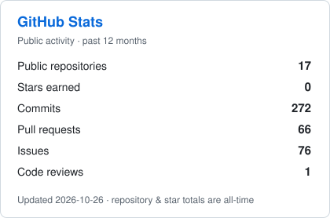
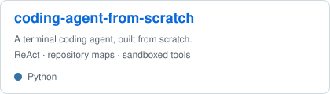
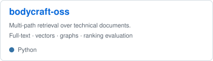
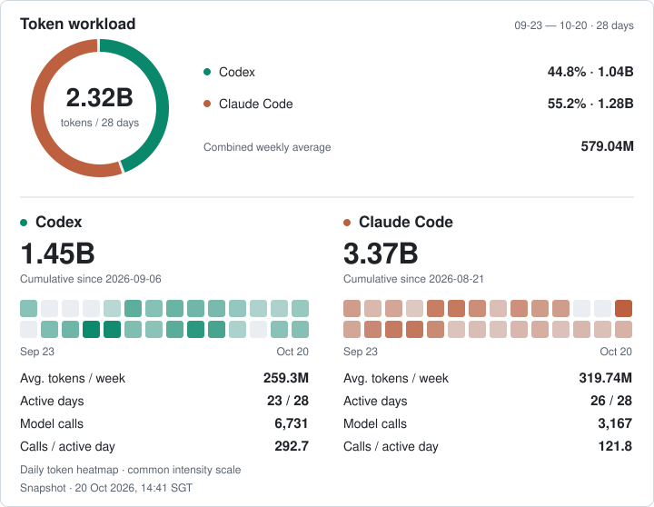

<h1 align="center">Rong He · 贺融</h1>

AI agents · Backend systems · Industrial vision

<table>
<tr>
<td valign="top" width="58%">

Hi, I'm <a href="https://rong.bio/en/">Rong</a> 👋 I build AI agents and backend systems. I'm studying software engineering at <a href="https://www.nus.edu.sg/">NUS</a> in Singapore, after a computer science degree at <a href="https://www.kaist.ac.kr/en/">KAIST</a>.

My work has taken me from camera-based assembly checks to agents for engineering teams at SAIC. I also enjoy the backend work that makes those tools usable: bringing data in, organising storage and running jobs in the background.

These days, I'm building a <a href="https://github.com/Darrenus/coding-agent-from-scratch">coding agent from scratch</a> and exploring hybrid retrieval with <a href="https://github.com/Darrenus/bodycraft-oss">bodycraft-oss</a>. I'm curious about how agents use tools and context, and I like testing which ideas actually help.

<b>Languages</b> 

<b>Agents &amp; retrieval</b> 

<b>Backend &amp; data</b> 

<b>Evaluation</b> 

<b>Computer vision</b> 

</td>
<td valign="top" width="42%">

<a href="https://github.com/Darrenus?tab=overview">
<picture>
  <source media="(prefers-color-scheme: dark)" srcset="assets/github-stats-dark.svg">
  
</picture>
</a>

<b>Featured</b>

<a href="https://github.com/Darrenus/coding-agent-from-scratch">
<picture>
  <source media="(prefers-color-scheme: dark)" srcset="assets/coding-agent-dark.svg">
  
</picture>
</a>
<a href="https://github.com/Darrenus/bodycraft-oss">
<picture>
  <source media="(prefers-color-scheme: dark)" srcset="assets/bodycraft-dark.svg">
  
</picture>
</a>

</td>
</tr>
</table>

## AI Workload

<picture>
  <source media="(max-width: 900px) and (prefers-color-scheme: dark)" srcset="assets/ai-workload-mobile-dark.svg">
  <source media="(max-width: 900px)" srcset="assets/ai-workload-mobile-light.svg">
  <source media="(prefers-color-scheme: dark)" srcset="assets/ai-workload-dark.svg">
  
</picture>

Local Codex &amp; Claude Code activity. Tokens include cached input; weekly averages use the last 28 days. Web chats and other devices are outside this snapshot. <a href="docs/ai-usage.md">Counting method ↗</a>

## Research

### Agents & LLM systems

- **[Does Failure Feedback Direct Agent Self-Modification?](https://arxiv.org/abs/2610.14662)** · arXiv, Oct 2026  
  When does failure feedback help an agent repair itself, and does the improvement transfer?
- **[Decomposition Buys Integrity, Not Yield](https://doi.org/10.48550/arXiv.2609.17464)** · arXiv, Sep 2026  
  The trade-off between smaller contexts and information lost across task decomposition.
- **[Prefix Sharing Is a Sorting Problem](https://doi.org/10.48550/arXiv.2609.13692)** · arXiv, Sep 2026 · [Code](https://github.com/Darrenus/prefix-sharing-is-sorting)  
  Ordering reusable prompt chunks to reduce prefill computation.

### Learning theory & mathematics

- **[Label Adaptivity in Best-of-n Budget Selection](https://zenodo.org/records/23086434)** · Zenodo, Oct 2026  
  Adaptive versus non-adaptive labelling under a limited correctness-label budget.
- **[From Pointwise Queries to Population Probabilities: A Sharp Preservation Threshold](https://zenodo.org/records/23020314)** · Zenodo, Sep 2026  
  When a restricted query interface preserves the difficulty of an inference problem.
- **[Sharp Limits on Time-Reversal Detection in Binary Hidden Markov Models](https://zenodo.org/records/22684761)** · Zenodo, Sep 2026  
  Sharp sample-complexity limits for detecting the direction of time.

All works above are preprints. <a href="https://rong.bio/en/research">Research notes &amp; full records ↗</a>

---

<a href="https://rong.bio/en/">Website</a> &nbsp;·&nbsp;
<a href="https://rong.bio/en/resume">Résumé</a> &nbsp;·&nbsp;
<a href="https://www.linkedin.com/in/herong">LinkedIn</a> &nbsp;·&nbsp;
<a href="mailto:hanserong@u.nus.edu">Email</a>

